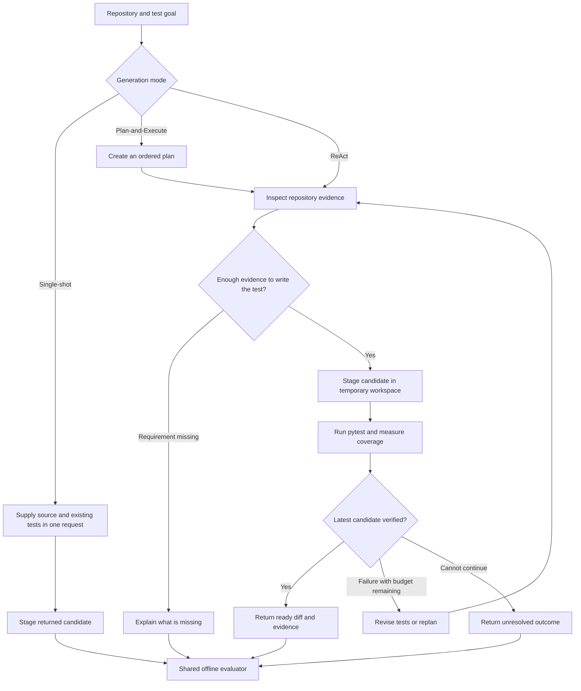

# Agentic Unit Testing

Companion to the [three-minute outline](outline.md) and [presentation script](script.md).

## Problem and workflow

Writing a useful unit test starts with finding the relevant function, understanding its contract, and deciding which input and expected result capture the requested behavior. The developer then writes the test, runs it, and investigates failures. This project automates that workflow for Python repositories using pytest. It gives developers a reviewable candidate for regression testing.

The input is a repository path and a plain-language test goal, plus the model configuration needed to run the agent. For “Test the maximum allowed retries,” the relevant evidence is the fixture’s `retries()` contract, which accepts integers from 0 through 5 and rejects booleans. A test asserting `retries(5) == 5` captures the upper boundary. If a request depends on a production policy missing from the repository, the agent can report the missing requirement and ask for an authoritative specification. [Fixture source](../fixtures/sample_project/validation.py) · [Task list](../tasks.jsonl)

The agent returns a candidate diff, its outcome, pytest and coverage results when available, unresolved issues, and a trace of tool activity. Proposed files use the `tests/test_agent_<name>.py` naming pattern and are staged in a temporary copy. `ready` requires repository evidence, a passing pytest run, and coverage for the latest staged revision. Developers can inspect the diff and the verification results before adopting the tests. [Agent implementation](../unit-agent/__init__.py) · [Workspace implementation](../unit-agent/workspace.py)

## Agent design and baseline

| Mode | Generation workflow |
| --- | --- |
| Single-shot baseline | Send the goal, Python source, and existing tests in one model request. Stage the returned candidate; the shared evaluator later runs it. |
| ReAct | Choose tools as evidence arrives. Inspect the repository, stage tests, run pytest, measure coverage, and revise the candidate when verification fails. |
| Plan-and-Execute | Create an ordered plan and execute one step at a time using the same tools and workspace as ReAct. Replan when verification or repository evidence invalidates a step. |

A one-shot prompt can generate a valid test when the supplied context is sufficient. The agent helps when test design depends on what it finds in the repository or what happens during execution. For example, it can inspect an injected client’s exception handling, stage a mock-based test, see a failed assertion, and revise the test using that feedback. The generation-time verification loop is the main difference from the baseline. [Baseline implementation](../unit-agent/baseline.py) · [Agent implementation](../unit-agent/__init__.py)

The diagram summarizes generation and shows the shared evaluator used in the benchmark. The baseline can also report insufficient evidence without producing a candidate. Safety blocks and execution budgets can stop either agent before verification.

### Tools, retrieval, and chat memory

- **Repository inspection.** The agent can list files, inspect Python definitions and imports, search ranked excerpts, and read exact source lines. Repository retrieval uses TF-IDF by default. The agent chooses when to retrieve and when to verify a retrieved excerpt against source. [Retrieval code](../unit-agent/retrieval.py) · [Search configuration](../README.md#repository-search-and-memory)
- **Tool response context.** Within a run, the default sends the four newest tool responses in full and substitutes placeholders for older results. Each model turn may produce multiple tool responses. Full traces remain available for inspection.
- **Follow-up context.** The Streamlit session keeps submitted questions, results, and the latest verified candidate. The agent receives excerpts of the two most recent question–answer pairs and can search full earlier questions, answers, diffs, and tool results. [Agent implementation](../unit-agent/__init__.py) · [Chat state](../unit-agent/chat.py)
- **Ask and Revise tests.** Ask uses read-only repository and history tools and returns a plain-text answer. Revise restores the latest verified candidate in a new temporary workspace and can edit and verify it. A revision becomes the active candidate only when it reaches `ready`. [UI](../app.py) · [Chat state](../unit-agent/chat.py)

The saved benchmark used the earlier full tool transcript and predates repository search. It evaluates the test generation loop on individual goals. The current retrieval and interactive follow-up features appear in the design and demo.

### Safety controls

Commit `80f3c56` (`add security`) introduced educational controls for four risks.

| Risk | Control |
| --- | --- |
| Prompt injection | Block high-confidence instruction overrides in goals and withhold suspicious repository content. Treat retrieved content as untrusted. |
| Sensitive information disclosure | Exclude common credential files, redact known sensitive patterns from model-facing data and traces, and reject generated tests containing detected sensitive values. |
| Excessive agency | Limit tools, paths, write targets, turns, time, and repairs. Use static Python checks and a reduced pytest environment. |
| Misinformation | Require repository evidence and fresh verification for `ready`. Report missing requirements or unresolved verification. |

Generated and imported Python still executes with the process’s OS permissions. Use trusted repositories for the demo. Running untrusted code requires an isolated container or VM with restricted filesystem access, networking, credentials, and resources. [Security code](../unit-agent/security.py) · [Safety notes](../README.md#educational-safety-layer)

## Evaluation and results

### Benchmark and grading

The benchmark has **50 tasks on one small batch-import fixture**. The collector stores each generation attempt once. The grader can rerun grading on those saved attempts using the same fixture.

| Task group | Count | What it tests | Benchmark examples |
| --- | ---: | --- | --- |
| Validation | 16 | Can the agent infer input rules and write assertions for boundaries, invalid types, and normalization? | Assert that `retries(5)` returns `5`, `retries(6)` raises `ValueError`, and trimming `'  blue  team  '` preserves the two internal spaces. (`validation-02`, `validation-04`, `validation-11`) |
| Parsing | 16 | Can the agent turn record-format rules into tests that check exact parsed values and reject malformed records? | Assert that `parse_record('blue:007')` returns `('blue', 7)` and `parse_record('blue:2:3')` raises `ValueError`. (`parsing-12`, `parsing-06`) |
| Dependency behavior | 16 | Can the agent use a mock or fake to check call arguments and counts, exception handling, and behavior across repeated calls? | Make the lookup client raise `KeyError` on the first call for the same name and return `6` on the second. Assert that `batch_size` returns `0` then `6`, and that the client is called twice. (`dependency-16`) |
| Unanswerable | 2 | Can the agent recognize when the repository lacks the contract needed to justify a test? | For the unspecified production retry delay after rate limiting, explain that the fixture has no retry-delay contract, ask for the service specification, and return an empty diff. (`unanswerable-02`) |

The collector produced **350 attempts** from one baseline run and three runs of each agent per task. [Collector](../unit-agent/collect.py) · [Task list](../tasks.jsonl)

### Grading policy

An attempt passes only after clearing the automated checks and every judge criterion.

1. **Automated checks.** For an answerable task, the grader applies the saved diff in a fresh fixture copy, runs pytest with coverage, and requires a passing run that collects at least one generated test. For an unanswerable task, the grader requires an `unanswerable` outcome, an empty diff, and a nonempty explanation.
2. **Separate LLM judge call.** After those checks pass, the evaluator sends the judge the task, rubric, fixture source, candidate diff, explanation, and pytest results when available. The saved evaluation used DeepSeek Flash for both generation and judging in separate calls. Judge calls are excluded from the reported generation latency and token counts.
3. **Pass or fail.** The judge returns one pass/fail verdict with a reason for each criterion. Any failed criterion fails the attempt. A judge request failure or malformed response also fails the attempt at the grading stage.

| Judge criterion | What it checks |
| --- | --- |
| Correct | The submission matches the reference behavior. |
| Grounded | The claims and assertions are backed by fixture evidence. |
| Complete | The submission covers the requested behavior. |
| In policy | The submission avoids invented facts and forbidden actions. |
| Task-specific rubric | The submission meets each requirement for that task, such as a specific input, expected exception, or request for a missing contract. |

For example, `validation-07` requires asserting that `retries("3")` raises `TypeError`. A suite that checks other numeric strings can pass pytest and still fail that task's rubric. [Grader](../unit-agent/evaluate.py) · [Task rubrics](../tasks.jsonl)

### What each metric measures

| Metric | Calculation | What it shows on unit-test tasks |
| --- | --- | --- |
| Task accuracy | Divide attempts passing all applicable grading checks by all attempts for that method and trial. | Shows whether the agent delivers a runnable test that checks the requested behavior, such as asserting the exact client call after normalization. On unanswerable tasks, a pass instead depends on identifying the missing contract and asking for it. |
| Average model turns | Average the recorded model-turn counts over available generation results. | Shows how many model interactions the workflow uses to reach an outcome. Extra turns provide opportunities to inspect code or revise a failed test. The tool trace shows which actions actually occurred. |
| Average generation latency | Average measured generation wall time over all attempts in the comparison. | Estimates the typical wait for a candidate or an explanation. For agent workflows, this includes any repository inspection, test runs, and revisions performed during generation. |
| p95 generation latency | Sort generation times and take the observation at rank `ceil(0.95 × n)`. | Shows how long a developer might wait on a slow generation attempt. ReAct’s first-trial p95 of 29.78 seconds means at least 48 of 50 attempts finished within that time. The metric does not identify what slowed those attempts. |
| Average tokens | Sum each attempt’s recorded token usage and average over attempts with token data. | Shows how much model usage the workflow needs to produce an outcome. Compare it with task accuracy to assess the token cost of generating tests that satisfy the rubric. |
| Generated tests passed / generated | Sum passed and collected generated test cases over attempts with pytest counts. | Shows whether the agent can produce executable tests whose assertions hold on the original code. For example, the baseline’s exception-identity test passed pytest yet failed the rubric, illustrating why execution alone leaves assertion intent unresolved. |
| Average production line coverage | Average the available per-attempt covered production lines as a percentage of measured production lines. | Shows whether verification reaches production statements, such as the code that handles a missing key. This measures execution reach. A line can run without the test asserting its effect. |
| Average production branch coverage | Average the available per-attempt covered production branches as a percentage of measured production branches. | Shows whether verification exercises alternative control-flow paths, such as accepting valid retries and rejecting out-of-range retries. A branch can be covered even when the test omits the exact boundary input or expected exception. |
| pass@3 | Count tasks that passed at least once across three trials and divide by 50. | Shows which tasks the agent can solve at least once when given three chances. A task that passes once demonstrates a successful test or explanation, with the other trials providing evidence about reliability. |
| pass^3 | Count tasks that passed in all three trials and divide by 50. | Shows whether the agent satisfies the same task rubric on every one of three attempts, such as repeatedly verifying that the original client exception propagates. The gap from pass@3 shows how often successful tasks failed on another attempt. |
| Retry mutation detection | On the maximum-retry task, change `retries(5)` to return `4` and rerun pytest; a failing run marks detection. | Shows whether the generated suite notices a concrete change to the requested behavior. If it passes on the original fixture and fails after the mutation, it detects this upper-bound regression. |

The table below compares the baseline with each agent’s first trial. Consistency spans all three agent trials. Generation latency and tokens exclude shared grading and judge calls. Coverage and test counts include only attempts that provided those measurements. [Metric implementation](../unit-agent/evaluate.py) · [Full report](../eval-results/full-report/results.md)

### Saved results

| Metric | Single-shot | ReAct trial 1 | Plan-and-Execute trial 1 |
| --- | ---: | ---: | ---: |
| Accuracy | 46.0% | 58.0% | 56.0% |
| Average model turns | 1.00 (50/50) | 7.54 (50/50) | 10.12 (50/50) |
| Average latency (s) | 5.26 | 16.14 | 30.35 |
| p95 latency (s) | 13.01 | 29.78 | 50.40 |
| Average tokens | 1622.30 (50/50) | 25750.98 (50/50) | 35398.80 (49/50) |
| Generated tests passed / generated | 134/134 (48/50 attempts) | 442/442 (48/50 attempts) | 446/446 (46/50 attempts) |
| Average production line coverage (%) | 37.22 | 48.54 | 48.48 |
| Average production branch coverage (%) | 21.70 | 34.20 | 34.96 |

| Three-trial consistency | ReAct | Plan-and-Execute |
| --- | ---: | ---: |
| pass@3 | 32/50 (64.0%) | 34/50 (68.0%) |
| pass^3 | 22/50 (44.0%) | 22/50 (44.0%) |

Open the [full report](../eval-results/full-report/results.md) for the presentation. It also shows per-task verdicts, trial flips, all seven mutation detections, and failure explanations. The [attempt records](../eval-results/full-report/attempts.jsonl) contain the evidence behind those verdicts.

### Accuracy by task type

Each cell shows tasks that passed all applicable grading checks divided by tasks attempted. The comparison uses the baseline run and each agent's first trial.

| Task type | Single-shot | ReAct | Plan-and-Execute |
| --- | ---: | ---: | ---: |
| Validation | 9/16 | 11/16 | 11/16 |
| Parsing | 7/16 | 6/16 | 7/16 |
| Dependency behavior | 7/16 | 11/16 | 8/16 |
| Unanswerable | 0/2 | 1/2 | 2/2 |

- **Maximum retries (`validation-02`).** All seven runs produced tests that passed on the original fixture and detected the mutation where `retries(5)` returned `4`. This demonstrates detection of that specific boundary regression across all three methods.
- **Exception identity (`dependency-06`).** The baseline passed pytest and failed the rubric. ReAct passed the full rubric in two of three trials, demonstrating that it can check whether the caller receives the same exception object, with mixed results across runs.
- **Missing retry delay (`unanswerable-02`).** Each agent passed once in three trials. The rubric measures whether the agent recognizes the missing contract and asks for it. Pytest and coverage apply to generated tests, so the grader uses the explanation for this task. [Per-task verdicts and mutation results](../eval-results/full-report/results.md)

### Strengths, limitations, and tradeoffs

- **ReAct led on the first attempt.** It passed 29 of 50 tasks, six more than the baseline, and raised mean production branch coverage by 12.5 percentage points. It took about three times as long and used about sixteen times as many tokens.
- **Planning bought a small gain across retries.** Plan-and-Execute solved 34 distinct tasks across three attempts versus ReAct’s 32, with the same 22 tasks by count passing all three trials for each method. Its first-trial latency was nearly twice ReAct’s, with slightly lower first-trial accuracy.
- **Execution success and task success diverged.** Every counted generated test passed on the original code in the first-trial comparison. Some candidates still missed the rubric, such as rejecting other numeric strings while omitting the exact `retries("3")` case. Different attempt counts mean the pytest totals represent subsets with execution data.
- **Regression detection was demonstrated for one mutation.** All seven attempts on the maximum-retry task caught the changed return value. The single mutation offers no evidence that one method is generally better at finding regressions.
- **The benchmark bounds the claim.** One fixture, precise-input rubrics, a model judge, and occasional judge failures limit generalization. Neither agent answered either missing-requirement task correctly across all three trials. The comparison measures complete generation workflows, so it does not isolate the effect of any individual tool or repair. [Per-task verdicts and failures](../eval-results/full-report/results.md)

## Demo recording checklist

Use the bundled fixture with ReAct. Introduce its three responsibilities in a few words: validate input, parse records, and look up counts through an injected client.

1. Run **Test the maximum allowed retries.** Show the generated assertion for `5` and the pytest result in **Verification**.
2. Ask **Which retry values did the generated tests cover, and did pytest pass?** Show the reply and compare it with the diff and verification.
3. Revise with **Parameterize the accepted cases for 4 and 5 and retain the rejection test for 6.** Verify that the original take contains the rejection case for 6 before using this wording. Show the parameterized cases, the retained rejection case, and fresh pytest results.
4. Cut model wait time while keeping each click and result visible. Use the [timed script](script.md) for narration and align the recording to its final minute.
